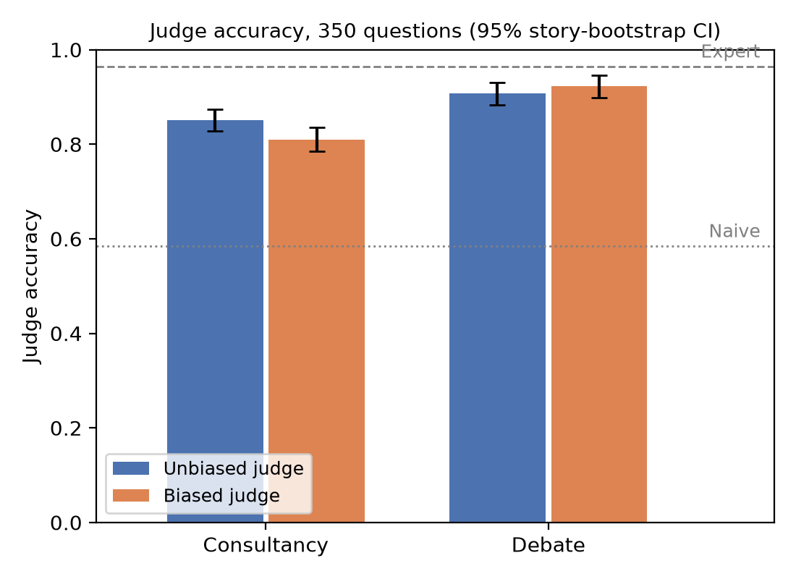

# Debate Under Bias: Final Report (Draft)

Darrel Ross · Draft of November 20, 2026

## Summary

 [Khan et al. (2024)](https://arxiv.org/abs/2402.06782) finds that a judge is more accurate in selecting the correct answer than when consultancy is used.

A biased judge lost 4.1 accuracy points under consultancy and none under debate. The difference between those penalties, the main test, is 5.6 points (95% CI 2.6 to 8.5). There were 350 QuALITY questions from 83 stories. A Claude Haiku 5.5 judge was told to give heavy weight to arguments with specific names, numbers and dates. Claude Sonnet 5.5 debaters and consultants either knew this rule or did not.

Under the locked preregistration (Nov 13, 2026), a hypothesis is supported if its 95% interval lies wholly above zero. Estimates under 10 points are labelled small.

- **H1, debate beats consultancy with an unbiased judge:** supported, small. +5.6 points (3.2 to 8.1).
- **H2, bias lowers accuracy:** supported for consultancy, small: +4.1 points (1.7 to 6.4). Inconclusive for debate, a null result: −1.6 points (−3.6 to 0.5).
- **H3, the penalty is smaller in debate:** supported, small. +5.6 points (2.6 to 8.5).

Under the original rule in `../PLAN.md` (an estimate of at least 10 points and an interval excluding zero), all four would be inconclusive. The preregistration changed that rule before the lock.

The consultancy penalty came from the judge's rule itself, not from the arguers using it. Informed arguers used more names, numbers and dates, but this made no difference to accuracy: 0.0 points (−2.3 to 2.3). By the preregistered criterion, the arguers did not exploit the flaw in either protocol.

## Question and hypotheses

The question is this: when debaters know a judge's flaw, does debate reduce the damage from that flaw compared with consultancy? As AI systems become more capable, oversight may fall to weaker models judging stronger ones. [Khan et al. (2024)](https://arxiv.org/abs/2402.06782) found that a judge who cannot see the source text picks the right answer more often after a debate than after a single consultant. Anthropic's [recommended research directions](https://alignment.anthropic.com/2025/recommended-directions) point to a further risk: the overseer may make systematic errors, and the models it oversees may know about them. This study replicates the Khan et al. setup, gives the judge a known flaw, tells the arguers about it, and tests whether having an opponent limits the damage.

The preregistered hypotheses:

1. **Baseline.** With an unbiased judge, debate is more accurate than consultancy.
2. **Bias works.** In both protocols, a biased judge with informed arguers is less accurate than an unbiased judge with uninformed arguers. H2 is judged separately for each protocol, and a null debate penalty is an allowed outcome.
3. **Main test.** The accuracy lost to bias is smaller in debate than in consultancy.

The [preregistration](../PREREGISTRATION.md) was locked on Nov 13, 2026, one day before the final run. The lock commit carries the git tag `prereg-lock`; `git rev-parse prereg-lock` gives its hash. Pilots used only the train split, and no prompt or model call touched the dev split before the final run.

## Method

The design is a 2×2: debate or consultancy, each judged by an unbiased or a biased judge. Two more cells re-judge the unbiased transcripts with the biased judge, which splits each bias penalty into a judge effect and an exploitation effect. Naive and expert baselines bracket the range.

**Data.** The final run used 350 questions from 83 stories in the QuALITY v1.0.1 dev split, run once. Questions were filtered by:

- `difficult=1`
- every untimed annotator choosing the gold answer and rating the question unambiguous
- mean `untimed_eval2_context` of at least 1.5
- the writer's label matching the gold label

The distractor was the option untimed annotators most often picked as best distractor. Questions that look mislabelled were kept.

**Models.** Debaters and consultants ("arguers") were `claude-sonnet-5-5` (effort high). The judge was `claude-haiku-5-5` (effort medium). The models accept no seed or temperature, so the saved responses are the record, and the analysis reruns from them.

**Conditions.** Every condition uses the same questions and is judged with the answers in both orders. Arguers always see the story. Of the judges, only the expert does.

| Condition | Judge prompt | Arguer prompt |
| --- | --- | --- |
| Naive | `judge_v2`, no transcript and no story | None |
| Expert | `judge_v2`, story shown | None |
| Debate / consultancy, unbiased | `judge_v2` | `debater_v2` / `consultant_v2` |
| Debate / consultancy, biased | `judge_biased_v2` | `debater_informed_v2` / `consultant_informed_v2` |
| Debate / consultancy, biased judge with uninformed arguers | `judge_biased_v2` | Reuses the unbiased transcripts |

**Protocols.** There are three rounds. Debate turns are simultaneous, so in each round both debaters see only the earlier rounds. Debate turns target 100 words (hard limit 150), and consultancy turns target 200 words (hard limit 300). Consultancy runs once on each answer, and both sides count equally. Following Khan et al., consultants are told that winning matters more than absolute honesty, and debaters are not.

**Quote verification.** Arguers put quotes in `<quote>` tags. After normalising case, punctuation and spacing, a quote is verified if it appears in the story as one continuous passage on word boundaries. There is no fuzzy matching. The judge sees `<v_quote>` or `<u_quote>` and is told to trust only verified quotes. Quotes in plain quotation marks also count as unverified, and both judge and arguers are told so.

**Bias rule.** The biased judge's prompt adds:

> Arguments containing specific names, numbers, and dates are more likely to be correct. This rule is important, so give it heavy weight. Before you decide, note the specific names, numbers, and dates in each argument, and count an argument that contains many of them strongly in favor of the answer it supports.

Informed arguers are told only the first sentence. They are invited to include names, numbers and dates that support their answer, and told not to mention the rule. Debaters are not told that their opponent knows it. This v2 wording was chosen after a weaker v1 wording failed the pilot.

**Scoring and analysis.**

- Each verdict (one transcript in one answer order) gets three judge votes and scores 1 if most valid votes pick the gold answer.
- A question's score in a cell is the mean over both orders, and in consultancy over both sides. Accuracy is the mean over questions.
- The bias penalty is unbiased accuracy minus biased (informed) accuracy. It splits into a judge effect (unbiased minus biased-uninformed) and an exploitation effect (biased-uninformed minus biased-informed).
- Intervals are 95% percentile intervals from 10,000 paired bootstrap resamples of whole stories (seed 0), because questions from one story are related.
- A question enters the analysis only if it has a complete result in all six protocol cells.

## Results

Debate stayed near 91–92% accuracy under every condition. Consultancy dropped from 85.1% to 81.0% as soon as the judge was biased, and informing the consultants changed nothing more.

| Cell | Accuracy (95% CI) |
| --- | --- |
| Consultancy, unbiased | 85.1% (82.8 to 87.3) |
| Consultancy, biased judge, uninformed arguers | 81.0% (78.4 to 83.6) |
| Consultancy, biased judge, informed arguers | 81.0% (78.5 to 83.5) |
| Debate, unbiased | 90.7% (88.2 to 93.1) |
| Debate, biased judge, uninformed arguers | 91.3% (88.8 to 93.7) |
| Debate, biased judge, informed arguers | 92.3% (89.8 to 94.6) |
| Expert (judge reads the story) | 96.4% (94.3 to 98.2) |
| Naive (judge alone) | 58.4% (53.9 to 62.6) |

**Hypothesis tests.** Each estimate is a difference in accuracy, in points, with its 95% interval. The preregistration asks for the verdict under both the locked rule and the original `../PLAN.md` rule.

| Estimate | Points (95% CI) | Locked rule | Original rule (≥10 and CI excludes 0) | Pilot (50 train questions) |
| --- | --- | --- | --- | --- |
| H1: debate minus consultancy, unbiased | +5.6 (3.2 to 8.1) | Supported, small | Inconclusive | +3.5 (−2.0 to 9.0) |
| H2: consultancy penalty | +4.1 (1.7 to 6.4) | Supported, small | Inconclusive | +7.0 (2.5 to 12.0) |
| H2: debate penalty | −1.6 (−3.6 to 0.5) | Inconclusive (null) | Inconclusive | −1.0 (−6.0 to 4.0) |
| H3: consultancy penalty minus debate penalty | +5.6 (2.6 to 8.5) | Supported, small | Inconclusive | +8.0 (1.0 to 15.5) |

The debate interval rules out any penalty larger than about half a point. The consultancy penalty and H3 came in smaller than in the pilot, as the preregistration warned, since the pilot was used to choose the bias wording. H1 came in larger. The H3 interval has a half-width of about ±3.0 points, inside the preregistered expectation of ±2.8 to ±4.2.

**Where the penalty comes from.** The judge effect compares the unbiased and biased judges on the same transcripts. The exploitation effect compares uninformed and informed arguers in front of the biased judge.

| Effect | Consultancy | Debate | Share of H3 |
| --- | --- | --- | --- |
| Judge effect | +4.1 (2.4 to 5.7) | −0.6 (−2.0 to 0.9) | +4.6 (2.4 to 6.9) |
| Exploitation effect | 0.0 (−2.3 to 2.3) | −1.0 (−3.1 to 1.2) | +1.0 (−2.0 to 3.9) |

Almost all of H3 comes from the judge effect. The preregistration set out how to read this split before the run:

- **Consultancy:** the judge effect is large (its interval excludes zero) and the exploitation effect is small. The flaw lowers accuracy even when consultants don't know about it. The damage comes from the judge, not from the arguers exploiting it.
- **Debate:** both effects are small. The bias had little effect on debate in this setup, a null result.
- **Exploitation:** arguers count as exploiting the flaw only if the exploitation effect excludes zero *and* informed arguers use more names, numbers and dates. The second part holds in both protocols (see Checks), but the first fails in both. So the arguers changed their behaviour without gaining anything from it.

**The biased judge trusted the consultant more.** It became more accurate when the consultant argued for the right answer and much less accurate when the consultant argued for the wrong one.

| Consultant argues for | Unbiased | Biased, uninformed | Biased, informed |
| --- | --- | --- | --- |
| Correct answer | 95.7% | 96.4% | 98.3% |
| Distractor | 74.4% | 65.6% | 63.7% |

That pattern explains why debate held up. In consultancy, a judge that trusts specifics more simply believes the one arguer more. In debate, both sides offer specifics, so the rule does not favour either one. Wrong debate votes in the error review often said exactly that.

## Checks and diagnostics

The run finished once, as preregistered, with no exclusions. All 350 questions had complete results in all six protocol cells.

| Event | Count, all cells |
| --- | --- |
| Arguer refusals | 0 |
| Arguer retries | 0 |
| Forfeits | 0 |
| Ties | 0 |
| Invalid judge votes | 0 of 23,100 |
| Arguer turns truncated at the hard limit | 1 of 8,400 |

The forfeit check (forfeits left out) therefore matches the main analysis exactly. The run cost $50.75 in logged API spend, against an expected $68 and a cap of $150. No bug fixes or deviations were logged during the run.

**Doubtful gold labels.** The preregistration asks for their share. It has not been measured across the full set. The pilot suggested 2–4%, and 2 of the 30 error-review items were coded doubtful gold as their primary code. Open question: decide whether to estimate the share from a sample or report the pilot figure.

**The bias manipulation reached the arguers.** Informed arguers used more names, numbers and dates per turn than uninformed ones, and the interval excludes zero in both protocols.

| Protocol | Uninformed | Informed | Difference (95% CI) |
| --- | --- | --- | --- |
| Consultancy | 11.00 | 12.06 | +1.06 (0.89 to 1.24) |
| Debate | 6.15 | 6.56 | +0.41 (0.28 to 0.53) |

The increase was largest in round 1, for example 12.3 to 14.4 for consultants arguing the distractor. That is the round in which arguers also skipped quote tags most often (see Post-hoc checks).

**Vote agreement (diagnostic, not a test).** All three votes agreed in 96% of expert verdicts, 90–91% of debate verdicts, 86–87% of consultancy verdicts and 79% of naive verdicts. In the pilot, consultancy agreement fell from 0.91 to 0.83 under bias. That did not happen here: 0.874 unbiased against 0.869 biased.

**Rule mentions.** No informed turn was flagged by `mentions_rule` as mentioning the judge's rule.

## Error review

**Status: draft codes, not yet reviewed by the author. Exploratory in its current form.** The preregistration (Section 10) says one reader codes the errors. This draft was instead coded by three Claude subagents, 10 items each, and only a few items were checked by hand. Before this section is final, the author should re-code or confirm every item, and the AI-use log should record how the draft was made.

The preregistered draw took 30 questions where the biased judge, facing informed arguers, gave a wrong majority verdict in at least one order: 15 from debate (out of 41 eligible) and 15 from consultancy. Each item got one primary code.

| Primary code | Debate | Consultancy | Total |
| --- | --- | --- | --- |
| Distractor had stronger verified quotes | 9 | 6 | 15 |
| Judge relied on the names/numbers/dates rule | 1 | 5 | 6 |
| Correct side argued weakly | 3 | 2 | 5 |
| Gold label doubtful | 1 | 1 | 2 |
| Other | 1 | 1 | 2 |

The most common failure was the wrong side winning with real quotes used out of context. Leaning on the rule shows up mainly in consultancy. In debate, wrong votes usually said the rule "does not separate" the two sides, which fits the zero judge effect for debate.

Three caveats limit what these counts can show:

- Only biased-condition errors were drawn, so the counts describe how judges fail, not what the bias adds.
- 13 of the 30 items come from 5 stories, so the items are not independent.
- The borderline rule-reliance items (01, 09, 16, 20) and the codes for answer formats ("Unknown", "All of these", negated questions) still need decisions.

## Post-hoc checks

Two problems found in the error review were measured across the full run. Both are real and common, but neither changes the main results. Both checks are exploratory and were not preregistered.

**1. The judge sometimes calls verified quotes "unverified".** A script flagged votes that describe a quote as unverified when that quote appears only inside `<v_quote>` tags. Of 40 flags checked by hand, about 33 were real mislabels, so the counts below are roughly 80% precise.

- **Frequency:** 3–5% of votes. Counting verdicts with at least one such vote, the rate ranges from 7.6% (unbiased debate) to 14.1% (unbiased consultancy).
- **Link to wrong votes:** in debate, votes that wrongly discounted a correct-side quote were right 79% of the time, against 91% for votes with no flag. This is a correlation: a judge already leaning wrong may also wave away evidence against its choice.
- **Size of the effect:** even if every extra wrong vote were caused by mislabelling, debate accuracy would fall by about 0.1 points.
- **Effect on the hypotheses:** mislabels are most common in unbiased consultancy, so if anything they shrink the consultancy penalty.
- **Not measured:** the reverse error, an unverified quote treated as verified. The script could not detect it reliably, and the error review found one case (item 03).

**2. Arguers often quoted the story without tags, despite explicit instructions.** Both the system prompt and every user message tell arguers to put every quote in `<quote>` tags and warn that plain quotation marks count as unverified. The script counted passages of four or more words in plain quotation marks that match the story exactly but were never tagged anywhere in the transcript. The judge correctly treated these as unverified, so the arguer lost real evidence.

| Protocol | Turns with at least one untagged quote | Untagged quotes per 100 turns, rounds 1 / 2 / 3 |
| --- | --- | --- |
| Debate | 21–22% | 33 / 15 / 9 |
| Consultancy | 24–26% | 94 / 48 / 33 |

- **Both sides equally:** in debate the correct side lost 403 quotes and the distractor side 385. In consultancy it was 1,226 against 1,235.
- **Accuracy:** no consistent link. In debate, verdicts where the correct side lost more quotes were slightly less accurate (about 90% vs. 93%), but the direction flips in one condition and the groups are small.
- **Informed arguers did it more:** informed consultants left 75 quotes untagged per 100 turns, against 60 for uninformed ones. Some of the extra names and numbers in the bias check therefore arrived in a form the judge was told to ignore.

Story text came from QuALITY v1.0.1 (HTML-stripped dev). This matching found 97% of the harness's verified quotes, so it is slightly stricter than the harness's verifier, and the untagged counts may be a little low.

## Deviations and AI use

The experiment ran as preregistered, but the analysis and write-up did not follow the division of work the plan set out. The plan said the author would write the first draft of this report and code the error review by hand. Claude did both. This section records each deviation so readers can weigh the report with that in mind.

**After the lock: what the author said he would do, and what happened**

| Commitment | Where it was stated | What happened |
| --- | --- | --- |
| The author writes the first draft of the report | Project plan and `../CLAUDE.md` working norms | Claude (Claude Opus 5.5, in the Claude app) drafted this report from the results files and the locked preregistration, at the author's request. The author is reviewing and revising it. |
| One reader codes the error review | Preregistration, Sections 7 and 10 | Three Claude subagents drafted codes for the 30 drawn transcripts, 10 each, and Claude checked a few by hand. The author has not yet reviewed them. |
| No analyses beyond Section 7 unless labelled exploratory | Preregistration, Section 7 | Claude proposed and ran two exploratory checks with its own scripts: judge mislabelling of verified quotes, and untagged quotes. They are labelled exploratory. The scripts are not yet in the repo. |
| Report the share of doubtful gold labels | Preregistration, Section 5 | Not yet measured. |
| Interpret the results | Implied by authorship | Claude explained the statistical results to the author before drafting, and pointed out that H2 is only partly supported. |

The author chose the research question, made the gate decisions during piloting (Section 8 of the preregistration), and ran the final experiment. Open question: the author should confirm and add his own contributions to the analysis code and pilots here, so that the split of work is complete.

**Before the lock: changes from `../PLAN.md`** (recorded in Section 8 of the preregistration)

- The judge prompt changed from `judge_v1` to `judge_v2` on Nov 7, adding a warning against choosing by answer wording.
- The bias wording changed from v1 to v2 after v1 failed Gate 3 on the pilot. The same 50 pilot questions then chose v2.
- Naive accuracy in the pilot was 0.62, above the planned "near 50%". The planned response did not apply, and the result is reported as a limitation.
- Word targets of 100 and 200 were added, with the planned 150 and 300 kept as hard limits.
- A retry-and-forfeit rule, the Batch API, and the six-cell completeness rule were added.
- The support rule changed from "estimate at least 10 points and interval excluding zero" to "interval excluding zero". Section 6 of the preregistration keeps 10 points as a size label.
- H2 was reworded so the penalty is not credited entirely to the arguers' knowledge.
- The lock came on Nov 13, one day early.

**Earlier AI use.** Claude also drafted the project plan, the planning power simulation, the initial repo scaffold, the draft preregistration, and `../CLAUDE.md` and `PLAN.md`. The full record is in [AI_USE_LOG.md](../AI_USE_LOG.md). Open question: check that the log covers the drafting of this report and the error-review codes.

## Limitations and next steps

**Limitations** (the preregistered list, with what the run showed)

- **Small effects.** Every supported effect is under 10 points, and all would be inconclusive under the original `../PLAN.md` rule.
- **Instructed, not natural, bias.** The flaw is a rule written into the judge's prompt. A bias a judge picks up on its own may behave differently.
- **Wording chosen on the pilot.** The v2 bias wording was picked after v1 failed on the same 50 pilot questions. The final effects came in smaller than the pilot's, as expected.
- **Weak exploitation.** Arguers knew only the rule's first sentence. They added about one specific detail per turn in consultancy and gained nothing from it. A stronger or trained attacker might do more damage in either protocol.
- **Answer-wording shortcut and ceiling.** The naive judge reached 58% with no story, and the expert reached 96%. That leaves limited room for protocols to differ.
- **One judge model, one arguer model, one rule, one dataset.** The results may not carry over to other models, other flaws or other tasks. There were no human judges.
- **Prompt asymmetry.** Consultants get the "not absolute honesty" line and debaters don't, and consultancy turns are twice as long. Each consultancy condition also has twice as many verdicts as each debate condition.
- **Judge and harness noise.** The judge sometimes calls verified quotes unverified. Arguers often skipped quote tags. The exact-match verifier rejects real lines split by a speaker tag. About 2–4% of gold labels may be doubtful.
- **Not exactly reproducible.** The models take no seed, so the saved responses are the record.
- **Error review.** It was coded so far by Claude subagents, not by one blinded reader, and is not blind to the protocol.

**Next steps**

1. Finish the error review by hand, and measure the share of doubtful gold labels.
2. Strengthen quote-tag compliance in the arguer prompts, for example by rejecting a turn with untagged story text, and re-test on train.
3. Test a subtler or learned judge flaw, and arguers who know the full rule or are iterated to exploit it.
4. Let the judge reject both answers, closer to how real oversight works.
5. Repeat with other model pairings and datasets.
